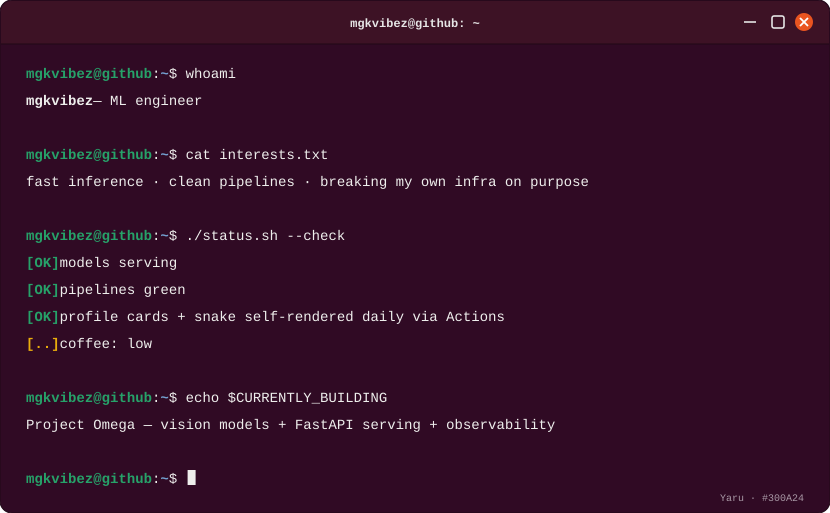
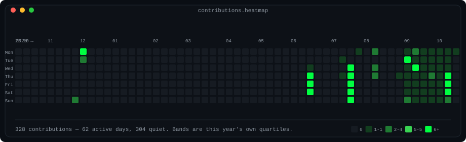
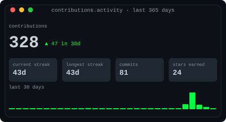
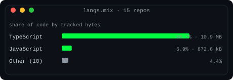
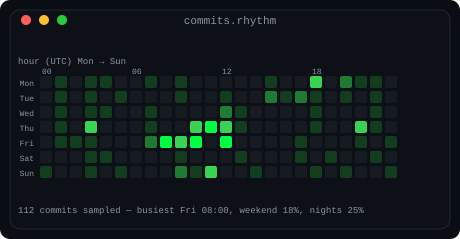
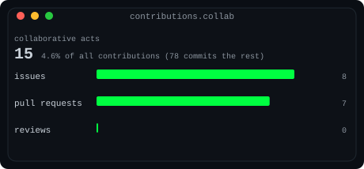
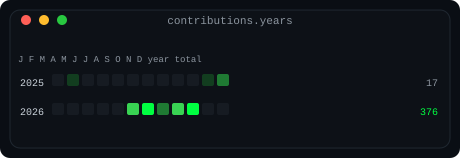
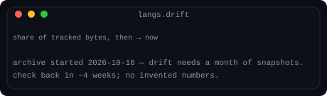

# openclaw-profile-cards

**Thirteen hand-drawn SVG stat cards for your GitHub profile — rendered by your own code, from the live GraphQL API. No third-party widgets, no API keys to a stats service, nothing phoning home.**

This is the generator behind [@mgkvibez](https://github.com/mgkvibez)'s profile. It renders one GraphQL round trip into thirteen themed cards plus a stats table, and a GitHub Action can commit them back daily so the profile stays current on its own.

<p align="center">
  
</p>

## The cards

| Card | What it shows |
| --- | --- |
| **whoami terminal** | A terminal session introducing the account — totals, stack, streak |
| **contribution heatmap** | A year of contributions; four bands that are quartiles of your own active days, with the numeric range of every band in the legend |
| **languages** | Byte share across every non-fork repo you own, folded "Other" bucket included |
| **activity** | 365-day total, current and longest streaks, a 30-day sparkline and the move against the prior 30 days |
| **collab** | PRs, reviews and issues as bars, with the collaborative share of everything you did |
| **rhythm** | A 7×24 heatmap of when you actually commit, from recent default-branch history |
| **years** | Every year one row, twelve monthly cells, totals column — the whole arc |
| **drift** | A dumbbell per language: share a month ago vs now, in points |
| **city** | Every repo a skyscraper — height by commits, facade by language, lit if pushed in the last 30 days |
| **loss curve** | A year of contributions converging like a training run |
| **oscilloscope** | Daily contributions as a phosphor waveform |
| **portscan** | Your repos as nmap services, state by last-push recency |
| **registry** | Your repos as deployed models in a registry |

<p align="center">
  <br>
  
  
  
  
  
  
</p>

## Three themes

Swap the whole set with one flag. Pictured on the terminal card:

| phosphor (default) | amber | paper (light) |
| --- | --- | --- |
|  |  |  |

## Quickstart

```console
git clone https://github.com/mgkvibez/openclaw-profile-cards.git
cd openclaw-profile-cards

# offline, no token needed — renders the bundled fixture
python -m cards.render --fixture testdata/profile.json --out my-cards

# live, for any user
GITHUB_TOKEN=ghp_xxx python -m cards.render --login <username> --out my-cards

# re-theme
python -m cards.render --login <username> --out my-cards --theme amber
```

Commit the SVGs to your profile repo (`username/username`) and reference them:

```markdown

```

## Self-updating profile

Copy [`examples/self-updating.yml`](examples/self-updating.yml) into your
profile repo's `.github/workflows/`, set a token secret, and the cards
re-render and commit themselves every day — the profile becomes a dashboard
that maintains itself. A `cards:table` block can also be injected between
`<!-- cards:table:start/end -->` markers in your README, refreshed on every run.

This repo dogfoods the same mechanism: the demo images above are rendered
nightly from live data by [its own workflow](.github/workflows/cards.yml).

## Use it as an agent skill

The repo ships with a `SKILL.md` — install it as an OpenClaw skill and an
agent can render or refresh anyone's profile cards on request, re-theme
them, and wire up the self-updating workflow for the user.

## Details worth knowing

- One GraphQL request pulls everything: contributions, repos, per-repo languages, recent commit timestamps, PR/issue/review counts, six years of calendars
- The `drift` card is honest on day one: it says the archive just started and fills in once a month of snapshots exists
- Standard library only; Python 3.10+; 32 tests, no fixtures faked
- SVGs stick to system monospace stacks — web fonts don't survive GitHub's camo proxy

## License

MIT — see [LICENSE](LICENSE).

<details>
<summary>Open the table view</summary>

<!-- cards:table:start -->

| Right now | Reading | Move |
|---|---|---|
| Contributions (365d) | 291 total | ▲ 19 in 30d |
| Last 30 days | 46 | see the activity card |

| Metric | Last 365 days | Move |
|---|---:|---|
| Contributions | 291 | — |
| Commits | 68 | — |
| Pull requests | 7 | — |
| Issues | 1 | — |
| Reviews | 0 | — |
| Current streak | 40d | — |
| Longest streak | 40d | — |
| Repositories | 21 | — |
| Stars earned | 7 | — |
| Followers | 21 | — |
| Collaborative acts | 8 (2.7% of all) | — |

| Language | Share | Tracked size |
|---|---:|---:|
| Python | 72.2% | 43.2 MB |
| TypeScript | 24.2% | 14.5 MB |
| Other (14) | 3.5% | — |

| Commit rhythm | Value |
|---|---:|
| Busiest slot | Fri 00:00 (12 commits) |
| Sample | 219 recent commits |
| Nights, 22:00–06:00 | 33% of the sample |
| Clock | UTC — every stamp came back without an offset |

| Year | Contributions |
|---|---:|
| 2025 | 17 |
| 2026 | 277 |

| Building | Commits | Size | Stars | Last push | State | Access |
|---|---:|---:|---:|---|---|---|
| ron-weasley-ii | 289 | 2.2 MB | 2 | 2026-10-16 | occupied | private |
| [mgkvibez](https://github.com/mgkvibez/mgkvibez) | 205 | 819 kB | 0 | 2026-10-16 | occupied | public |
| Tinda | 90 | 904 kB | 0 | 2026-09-15 | occupied | private |
| [Lisa-1](https://github.com/mgkvibez/Lisa-1) | 17 | 16.6 MB | 2 | 2026-08-14 | quiet | public |
| kratos-ii | 8 | 108 kB | 1 | 2026-09-15 | occupied | private |
| odia | 8 | 4.3 MB | 0 | 2026-06-18 | dormant | private |
| [sharpsharp-bmoni](https://github.com/mgkvibez/sharpsharp-bmoni) | 6 | 61 kB | 1 | 2026-10-16 | occupied | public |
| voiceprint | 6 | 90 kB | 0 | 2026-10-15 | occupied | private |
| lisa | 3 | 69 kB | 0 | 2026-08-13 | quiet | private |
| Agents | 3 | 7 kB | 0 | 2026-07-22 | quiet | private |
| [bolt](https://github.com/mgkvibez/bolt) | 3 | 14.1 MB | 0 | 2026-06-18 | dormant | public |
| [bolt.diy](https://github.com/mgkvibez/bolt.diy) | 3 | 2.1 MB | 0 | 2026-06-18 | dormant | public |
| [Agentic-project](https://github.com/mgkvibez/Agentic-project) | 2 | 3 kB | 0 | 2026-07-22 | quiet | public |
| [open_hands](https://github.com/mgkvibez/open_hands) | 2 | 1 kB | 1 | 2026-07-14 | dormant | public |
| [the-intel](https://github.com/mgkvibez/the-intel) | 2 | 1.5 MB | 0 | 2025-11-30 | dormant | public |
| openclaw | 1 | 53 kB | 0 | 2026-08-12 | quiet | private |
| [bolt.gives](https://github.com/mgkvibez/bolt.gives) | 1 | 5.7 MB | 0 | 2026-06-18 | dormant | public |
| [the-intels](https://github.com/mgkvibez/the-intels) | 1 | 23 kB | 0 | 2025-12-01 | dormant | public |
| blog-agility-cms-nextjs | 1 | 154 kB | 0 | 2025-12-01 | dormant | private |
| bolt.new | 1 | 841 kB | 0 | 2025-12-01 | dormant | private |
| qttx-app | 1 | 2 kB | 0 | 2025-02-11 | dormant | private |

_Private repositories are listed for their activity only — they are not linked, because the link would 404 for everyone but me._

_Generated by `cards/` on 2026-10-18, from the live GitHub GraphQL API. Table maintained between the cards:table markers._
<!-- cards:table:end -->

</details>
